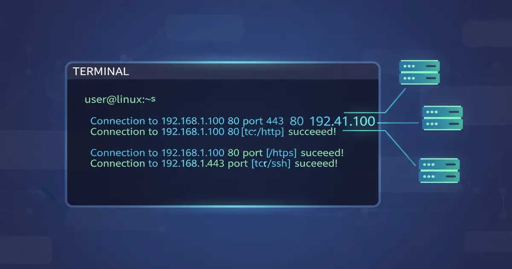

# Basic Netcat in Python

_Netcat_ é uma ferramenta ótima de linha de comando, a minha versão seria uma mais básica dela em python, ela faz apenas a conexão cliente-servidor para comunicação entre os scripts e permite comandos no outro lado como se fosse uma _reverse shell_.

## Functions

- **Listening mode:** Ele atua como um servidor para aceitar conexões de entrada do script `client`.
- **Client mode:** Faz a conexão no endereço do servidor utilizando a mesma porta.

## Details

Para entender detalhadamente como o código funciona, acesse os [Detalhes](/docs/details.md).
